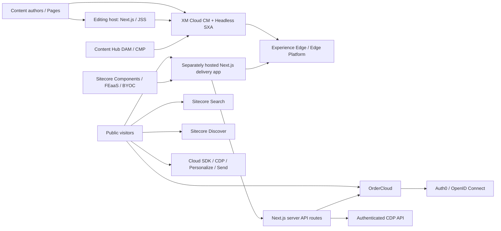

# PLAY! Summit XM Cloud — Project Discovery

## 1. Scope and executive summary

**Snapshot:** branch `main`, commit `1ea92e5` (`2025-12-18`, “Fix React Server Components CVE vulnerabilities (#220)”). Inspected on `2026-10-08`. The working tree was clean before this report. This is a source-based discovery, not a certification of a deployed environment.

**What this project is:** Sitecore's PLAY! Summit composable DXP demonstration on XM Cloud. Its main experience is an event website; the same Next.js application also contains PLAY! SHOP commerce, account management, marketing-channel simulations, and a customer-service demonstration. The repository explicitly says it is **not a starter kit**, is not supported by Sitecore Product Support, and is provided without warranty. [Source: `../README.md`](../README.md)

**Overall assessment:** useful for learning and demonstrating XM Cloud integrations, but not a production-ready baseline. The main architecture is recognizable JSS/SXA, with substantial demo-specific coupling and operational shortcuts. Before public production deployment, prioritize API authorization, configuration/secret hygiene, consent, payment behavior, and integration tests. See sections 11–13.

### Important distinctions

- **XM Cloud editing host is not the public delivery website.** This repository's XM Cloud deployment provisions the authoring environment and its editing host. Its deployment guide requires a separately hosted delivery frontend, such as Vercel. [Source: `deploying.md`](deploying.md)
- **Sitecore-first, not code-first.** Templates, renderings, presentation, and content are authored in Sitecore and serialized into Git. React implements the named renderings. Storybook is the disconnected UI-development route. [Source: `website.md`](website.md)
- **One frontend, different content ownership.** Event pages use Sitecore layout data; shop/account/search/channel/customer-service routes include directly implemented Next.js pages. Editing a shop page is not equivalent to editing an SXA page. [Sources: `src/pages`](../src/rendering/src/pages), [multisite exclusions](../src/rendering/src/lib/middleware/plugins/multisite.ts)
- **Integration code does not prove tenant provisioning.** Most integration settings are empty in the checked-in environment files. There is no verified XM Cloud project, Experience Edge publication, Vercel project, Search index, OrderCloud marketplace, or Content Hub tenant in this discovery.
- **Naming note:** current official documentation labels XM Cloud as SitecoreAI. This report retains the repository's XM Cloud terminology; no migration to Content SDK or another product/version is inferred. [Official build configuration][official-build]

## 2. Repository map and scale

| Area | Purpose | Observed scale |
| --- | --- | --- |
| [`src/rendering`](../src/rendering) | Next.js/JSS application, API routes, styles, Storybook, build generators | 660 files in `src/`; 198 component `.tsx` files; 30 page `.tsx` files; 26 API `.ts` files |
| [`src/items`](../src/items) | Sitecore Content Serialization (SCS) exports | 1,256 `.yml` files; 1,254 unique database/item-ID pairs; 2 role exports without item IDs |
| [`src/platform`](../src/platform) | .NET Framework CM customizations, patches, Web Forms utilities | 42 files; one application project |
| [`src/components`](../src/components) | Serialized Sitecore Components collections, styles, data sources, versions | 11 JSON-named files; 8 component-version files |
| [`src/personalize`](../src/personalize) | Embedded Personalize flow definitions | 3 JSON files |
| [`src/icons`](../src/icons) | Rendering icons | Multiple icon resolutions; ZIP deployed with platform |
| [`docker`](../docker) | Local Windows-container environment and Azure DevOps pipeline | CM, rendering, SQL, Solr, Traefik, initialization/build services |
| [`ps-modules`](../ps-modules) | Components and Personalize import/export helpers | 2 modules |
| [`ch-one`](../ch-one) | Content Hub ONE demo submodule | Pinned to `33f7b7e`; **not initialized** in this checkout |
| Root scripts/config | Initialization, startup, serialization, token generation, build orchestration | PowerShell scripts, solution, Dockerfile, XM Cloud and CLI settings |
| [`docs`](.) | Existing setup, deployment, contribution and upgrade guides | Main documentation location |

Counts above are file counts, not counts of independent CMS renderings or test cases. Most React files include supporting UI rather than directly registered Sitecore renderings.

### Content serialization groups

| Group | Files | Group | Files |
| --- | ---: | --- | ---: |
| `sxa-content` | 583 | `templates` | 310 |
| `cmp-config` | 112 | `sxa-media` | 89 |
| `sxa-renderings` | 68 | `play-microsite` | 36 |
| `demo-workflow` | 11 | `sxa-placeholders` | 9 |
| `rendering-contents-resolvers` | 6 | `page-structure-placeholders` | 6 |
| `content-hub-default-template` | 5 | `headless-placeholders` | 4 |
| `powershell-scripts-warmup` | 3 | Other groups combined | 14 |

The public-assets directory is approximately **97.5 MiB**, and the tracked GraphQL introspection file approximately **9.2 MiB**. These are repository/disk sizes, not measured browser bundle or transferred-page sizes. [Sources: `public`](../src/rendering/public), [introspection](../src/rendering/src/temp/GraphQLIntrospectionResult.json)

## 3. Technology and version baseline

Resolved frontend versions are from [`package-lock.json`](../src/rendering/package-lock.json); requested ranges and scripts are in [`package.json`](../src/rendering/package.json).

| Technology | Observed version/configuration | Notes |
| --- | --- | --- |
| Next.js | `14.2.35` | **Pages Router**, not an App Router architecture |
| React / React DOM | `18.2.0` | Strict Mode enabled |
| Sitecore JSS Next.js | `22.2.1` resolved; `~22.2.0` requested | XM Cloud, SXA and multisite add-ons |
| TypeScript | `4.9.4` | Strict enabled, but null checks and strict function types disabled |
| Tailwind CSS | `^3.0.23` requested | PostCSS imports/nesting/mixins; extensive component CSS |
| Storybook | `7.6.15` | Next.js framework integration; 111 story files |
| Sitecore Cloud SDK core/events | Core `0.4.2` resolved | Context-aware browser analytics |
| Sitecore Engage | `1.4.2` resolved | Also retained as a dependency; legacy Boxever integration exists |
| Sitecore Search React SDK | `2.2.2` resolved | Content search and recommendations |
| Sitecore Discover React SDK | `1.1.1` resolved | Product discovery/recommendations |
| Auth0 Next.js SDK | `1.7.0` | Optional commerce authentication |
| Redux Toolkit | `^1.9.5` requested | OrderCloud browser state |
| .NET Framework | `4.8` | Classic Web Application project, not ASP.NET Core |
| XM Cloud Node pin | `20.10.0` | Also pinned in local Docker and Azure pipeline |
| Sitecore CLI | `5.1.25` | CLI plugins mostly `5.2.113`; XMCloud plugin `1.1.99` |
| Local infrastructure | XM Cloud `1-ltsc2019`, SQL Developer 2017, Solr `8.11.2`, Windows images | Development topology, not a production hosting recommendation |

The NuGet baseline is partly floating: XM Cloud packages use `1.*`, the CMP connector `5.*`, and Headless Services assemblies `19.*`; some JSS/GraphQL packages have fixed older versions. This makes compatibility with the actual deployed CM image an important validation step. [Sources: `Packages.props`](../Packages.props), [platform project](../src/platform/Platform.csproj), [CLI tools](../.config/dotnet-tools.json), [CLI plugins](../sitecore.json)

There is no `engines` declaration or checked-in `.nvmrc`. Documentation disagrees on Node prerequisites: global prerequisites say 16; quick start says 18/20; actual host/pipeline pin is 20.10.0. This is documentation drift, not evidence that all those versions are supported. [Sources: `prerequisites.md`](prerequisites.md), [quick start](quick.md), [XM Cloud build](../xmcloud.build.json), [pipeline](../docker/build-and-push-images.yml)

## 4. Architecture and request lifecycle



This depicts code-level integration boundaries, not verified deployed infrastructure. [Sources: `deploying.md`](deploying.md), [application services](../src/rendering/src/services), [API routes](../src/rendering/src/pages/api), [platform pipelines](../src/platform/Pipelines)

### CMS-managed request

1. Next.js middleware runs ordered plugins: **multisite (`-1`) → redirects (`0`) → personalize (`1`)**. Multisite resolves the site and rewrites the URL; personalization can select page/component variants. Redirects and personalization are disabled in development. [Source: middleware plugins](../src/rendering/src/lib/middleware/plugins)
2. [`pages/[[...path]].tsx`](../src/rendering/src/pages/[[...path]].tsx) handles CMS routes. `getStaticPaths` returns **no prebuilt paths** and uses `fallback: 'blocking'`. Pages are generated on demand with **ISR revalidation of 5 seconds**. This does not guarantee content reaches every visitor five seconds after publishing.
3. The page-props factory resolves site and locale, fetches layout/dictionary data, handles editing preview, fetches component-level data/styles/themes, and applies personalization. Plugins run in order. [Source: page-props factory](../src/rendering/src/lib/page-props-factory)
4. The GraphQL client prefers `SITECORE_EDGE_CONTEXT_ID`; otherwise it uses `GRAPH_QL_ENDPOINT` plus `SITECORE_API_KEY`. The default layout-fetch mode in the rendering `.env` is GraphQL; a REST branch also exists. [Sources: client factory](../src/rendering/src/lib/graphql-client-factory/create.ts), [layout factory](../src/rendering/src/lib/layout-service-factory.ts)
5. SitecoreContext and ComponentPropsContext wrap [`Layout.tsx`](../src/rendering/src/Layout.tsx). Named components render into `headless-header`, `headless-main`, and `headless-footer`.
6. Global scripts wire editing helpers, FEaaS/BYOC, Cloud SDK page events, legacy CDP, and Send; Search widgets are enabled when Search configuration is complete. [Sources: `_app.tsx`](../src/rendering/src/pages/_app.tsx), [`Scripts.tsx`](../src/rendering/src/Scripts.tsx), [`Bootstrap.tsx`](../src/rendering/src/Bootstrap.tsx)

### Editing request

The application provides `/api/editing/render`, `/api/editing/config`, `/api/editing/data/[key]`, and `/api/editing/feaas/render`. JSS middleware handles editing/preview mechanics. The preview plugin supports **metadata edit mode** and the legacy chromes mode used by Experience Editor. The render endpoint accepts 2 MiB request bodies. Ensure an environment-specific editing secret and appropriate editing-data caching for the hosting platform. [Sources: editing routes](../src/rendering/src/pages/api/editing), [preview plugin](../src/rendering/src/lib/page-props-factory/plugins/preview-mode.ts)

### Build-generated files

`npm run bootstrap` generates plugin registries, runtime configuration, the component builder, metadata and category data. `next.config.js` imports generated files, so bootstrap is required before a fresh `next build`/`next dev` workflow. Treat generated files as outputs, not customization points. Configuration generation also attempts to fetch multisite information from Sitecore, so an empty route prebuild list does **not** make the full build independent of Sitecore connectivity. [Sources: bootstrap](../src/rendering/scripts/bootstrap.ts), [config generation](../src/rendering/scripts/generate-config.ts), [site metadata fetching](../src/rendering/scripts/config/plugins/multisite.ts)

## 5. Sitecore content model and authoring

### Main tree and presentation

The principal site is `/sitecore/content/PLAY/playwebsite`. Its Site Grouping uses site name `playwebsite`, wildcard hostname/environment, rendering host `Default`, and item/field language fallback. Wildcard resolution is useful in a demo but needs deliberate host mappings if adding sites. [Source: Site Grouping item](../src/items/sxa-content/content/PLAY/playwebsite/Settings/Site%20Grouping/playwebsite.yml)

The tree includes `home`, shared `Data`, `Dictionary`, `Settings`, and `Presentation`. Presentation includes designs, partial designs, styles and headless variants. Developer templates are split between `Project/PLAY` SXA/site structures and `Project/Global` reusable/global content. [Sources: site items](../src/items/sxa-content/content/PLAY/playwebsite), [templates](../src/items/templates/Project)

CMS routes include sessions, speakers, sponsors, vendors, news, tickets, landing pages, about-us, contact, map, FAQ, support, media, privacy and terms. Serialized collections contain 26 direct session children, 20 speaker children, 11 sponsor children, 14 vendor children and 5 news children; these counts include any helper/data nodes and should not be treated as a validated published-page inventory. [Source: home tree](../src/items/sxa-content/content/PLAY/playwebsite/home)

### Business entities and relationships

| Entity | Core fields / relations |
| --- | --- |
| Session | Name, description, image, premium flag, audience, type, days, timeslots, rooms, speakers, sponsors, vendors |
| Speaker | Name, picture, biography, role, featured flag, company/job title/location, sessions, sponsors, vendors |
| Sponsor | Name, description, level, logo, sessions, speakers |
| Vendor | Name, description, level, activity type, logo, sessions, speakers |
| News | Title, excerpt, content, publication date, image, audience |
| Room / Venue | Capacity/size, descriptions, images; venue-room and room-session relationships |
| Reference data | Audience, Day, Timeslot, Level, Activity Type, Session Type, Speaker Type |
| Other CMP entities | Advertisement and Testimony |
| Reusable page content | Hero/banner, CTA sections, features, testimonials, product-category grids, questionnaire, Send embed, payment progress |

These are serialized template relationships, not a relational database schema or a claim that reciprocal relationships are automatically consistent. [Sources: CMP entity templates](../src/items/templates/Project/Global/CMP%20Entities), [shared templates](../src/items/templates/Project/Global), [frontend types](../src/rendering/src/types)

### Data delivery and GraphQL

Rendering data comes from normal layout fields, configured rendering contents resolvers, and **integrated GraphQL queries serialized on rendering items**. Eleven non-empty `ComponentQuery` shared fields were found. For example, SessionsGrid queries a fixed item ID and requests up to 200 children. There are **no checked-in `.graphql` document files**, despite GraphQL-let configuration and introspection tooling. This is a CMS-first query workflow; do not assume every field is covered by generated operation types. [Sources: SessionsGrid rendering](../src/items/sxa-renderings/Project/PLAY/Sessions/SessionsGrid.yml), [resolvers](../src/items/rendering-contents-resolvers), [GraphQL-let config](../src/rendering/.graphql-let.yml)

### Workflow and languages

The demo workflow has Draft, Awaiting Approval, and Approved states, with an auto-submit action for a configured editor role and auto-publish on approval. Separately, CMP import customizations initiate publishing to Experience Edge. Editorial approval expectations should be explicitly tested rather than assumed to govern every import path. [Sources: workflow](../src/items/demo-workflow), [CMP publish processor](../src/platform/Pipelines/PublishSyncedItem.cs)

Language configuration is inconsistent:

- Frontend locales: `en`, `fr-CA`, `ja-JP`.
- XM Cloud post-deployment publishing languages: `en`, `fr-CA`.
- Explicit serialized language definition added by this solution: `fr-CA`; default English is excluded from that module.
- Serialized item versions also contain `da`, `de-DE`, `ja-JP`, and `zh-CN`.
- Redirect middleware declares only `en`; Search context is hard-coded to English/US.

The presence of item versions does not establish that the corresponding language definitions, content coverage, redirects and Search localization are ready. [Sources: Next config](../src/rendering/next.config.js), [build configuration](../xmcloud.build.json), [InitItems module](../src/InitItems.module.json), [redirects](../src/rendering/src/lib/middleware/plugins/redirects.ts), [`_app.tsx`](../src/rendering/src/pages/_app.tsx)

## 6. Frontend features and ownership boundaries

| Feature area | Source / routes | Ownership |
| --- | --- | --- |
| Event discovery and editorial content | CMS catch-all; Sessions, Speakers, Sponsors, Vendors, News components | Sitecore content/layout + React implementations |
| Marketing content | PageContent components, questionnaire, request/sponsor/attendee forms | Mostly CMS-assembled demo UI |
| Ticket purchase | CMS ticket pages; `models/mock-tickets.ts`; Payment components | Mock ticket catalogue and analytics-driven simulated purchase |
| Shop / product catalogue | `/shop`, `/shop/products/[...sections]`, `/shop/categories/[...sections]` | Direct Next.js pages + OrderCloud/Discover |
| Cart and checkout | `/shop/checkout/*` | React/Redux + OrderCloud; demo calculations/payments |
| Account | `/account/*` | Direct pages; user/address/order/payment UI |
| Content Search | `/search`; ContentSearch and PreviewSearchContent components | Sitecore Search widgets |
| Marketing channels | `/channels/facebook`, `/channels/google`, `/channels/linkedin` | Channel simulations, not actual social-network integrations |
| Customer service | `/careconnect` | Demo guest/profile/next-best-offer interface |
| FEaaS/BYOC | `src/byoc`, wrappers, `/feaas/render` | Components service plus embedded external code/components |

[Sources: pages](../src/rendering/src/pages), [components](../src/rendering/src/components), [commerce state](../src/rendering/src/redux), [ticket model](../src/rendering/src/models/mock-tickets.ts)

Shop rendering is enabled only when **both Discover keys and OrderCloud base URL/buyer client ID** are present. Authentication additionally requires Auth0 enabled plus OpenID Connect configuration. Thus an OrderCloud-only environment is not sufficient to enable the existing shop. Redux owns authentication, current cart, user, address book, product caches/details/lists and errors. ShopLayout loads commerce providers conditionally rather than adding them to every CMS page. [Sources: commerce gate](../src/rendering/src/helpers/CommerceHelper.ts), [authentication gate](../src/rendering/src/services/AuthenticationService.ts), [ShopLayout](../src/rendering/src/components/Products/ShopLayout.tsx), [store](../src/rendering/src/redux/store.ts)

## 7. Integration inventory and configuration contract

| Integration | Responsibility | Required configuration / external dependency |
| --- | --- | --- |
| XM Cloud / Experience Edge | Layout, dictionary, multisite metadata, publishing | `SITECORE_EDGE_CONTEXT_ID`, normally `SITECORE_SITE_NAME=playwebsite`; alternatively GraphQL endpoint + API key |
| Editing host | Pages/Experience Editor rendering | Public URL/host mapping and matching environment-specific editing secret |
| Cloud SDK / embedded Personalize | Context-aware page/events, variants, A/B testing | Context ID; optional `NEXT_PUBLIC_PERSONALIZE_SCOPE`; timeout settings |
| Legacy CDP / Boxever | Guest identity, data extensions, audience/ticket events, dynamic messages | Public CDP client key/target; server-only `CUSTOM_CDP_API_TOKEN` and authenticated API target |
| Sitecore Search | Content search, suggestions, profile affinities/recommendations | `NEXT_PUBLIC_SEARCH_ENV`, customer key and browser-appropriate API key; compatible Search domain schema |
| Sitecore Discover | Product search/recommendations | `NEXT_PUBLIC_DISCOVER_CUSTOMER_KEY`, `NEXT_PUBLIC_DISCOVER_API_KEY`; provisioned product domain |
| OrderCloud | Buyer catalogue/cart/account/order operations | Buyer client ID, API URL; server middleware credentials; `OC_API_CLIENTS_WITH_ACCESS`, `OC_WEBHOOK_HASH_KEY` for Catalyst |
| Auth0 / OIDC | Commerce sign-in and identity synchronization | Auth0 issuer/client/base URL/session secret; OrderCloud OpenID Connect ID |
| Content Hub DAM/CMP | Assets and entity synchronization | CM connection strings, Content Hub credentials and Service Bus configuration |
| Sitecore Components / FEaaS | Serialized visual components and external-code rendering | Components library ID/key, external component registration, correct library/content references |
| Content Hub ONE | Components data sources / companion demo | Submodule and provisioned ONE delivery configuration |
| Sitecore Send | Tracker and embedded forms | `NEXT_PUBLIC_SEND_WEBSITE_ID`; separately managed website/forms configuration |

[Sources: rendering services](../src/rendering/src/services), [frontend bootstrap](../src/rendering/src/Bootstrap.tsx), [middleware](../src/rendering/src/lib/middleware/plugins), [Docker environment mapping](../docker-compose.override.yml), [Components module](../ps-modules/SitecoreComponents/SitecoreComponents.psm1), [integration setup docs](website.md)

### Configuration observations

- The root `.env` feeds Docker/CM; `src/rendering/.env` feeds direct frontend commands. Docker maps several root variables into different `NEXT_PUBLIC_*` names. Setting only the root file does not configure a frontend launched directly with npm. [Source: Docker override](../docker-compose.override.yml)
- The checked-in frontend has an empty Context ID, but `scjssconfig.json` supplies a local CM hostname/API key fallback. An untouched frontend can therefore attempt local CM access rather than connect to a working shared demo. [Source: scjssconfig plugin](../src/rendering/scripts/config/plugins/scjssconfig.ts)
- For delivery, use a **Live** context; for authoring, use a **Preview** context. Current official guidance treats generated environment Context IDs as secrets and recommends scoped public IDs for client-side access. This app's generated configuration is imported by browser Bootstrap/BYOC, so review actual browser exposure and scopes rather than relying on the absence of a `NEXT_PUBLIC_` prefix. [Sources: config generator](../src/rendering/scripts/generate-config.ts), [Bootstrap](../src/rendering/src/Bootstrap.tsx), [BYOC](../src/rendering/src/byoc/index.tsx), [official Context ID guidance][official-context]
- Search domain setup must include the sort option `featured_desc` and suggestion block `content_name_context_aware` referenced by the UI. Crawlers parse Next.js `__NEXT_DATA__` plus rendered HTML and are coupled to current page fields/structure. [Sources: Search docs](website.md), [crawler scripts](../src/rendering/search-crawlers)
- Legacy CDP and Context-aware Cloud SDK run side by side. Identity/ticket/Search-profile events are sent through multiple integration paths; define intentional event ownership before consolidating or upgrading. [Sources: identification](../src/rendering/src/services/IdentificationService.ts), [legacy CDP](../src/rendering/src/services/CdpService.ts), [Cloud SDK](../src/rendering/src/services/CloudSDKService.ts)
- Components and Personalize assets are imported/exported with separate PowerShell scripts, not automatically restored merely by deploying the main SCS modules. [Source: asset serialization docs](website.md)

## 8. CM/platform customization

The solution contains one .NET Framework 4.8 project, `Platform`. The `Foundation` solution folder exists, but the `Foundation/BranchPresets` project described in older docs is absent. [Sources: solution](../Sitecore.Demo.Edge.Website.sln), [project](../src/platform/Platform.csproj), [older project description](website.md)

Key customizations:

- `DemoContextExtension`: adds event start/title information and available languages to layout context, using a hard-coded config item path.
- `CmpListField`, `DemoCmpFieldMapping`, `DemoFieldTypeFactoryStore`: support CMP-derived multilist values and their editor/Layout Service/GraphQL representation. Mapping may use `sitecore_master_index` to resolve display names.
- `DemoImageFieldSerializer`, `ParseXml`: customize external DAM image handling and transformations.
- `PublishSyncedItem`: asynchronously publishes imported CMP items and related descendants to `experienceedge`.
- `LoadBalancingSchemeFix`: adjusts request scheme behavior behind a proxy.
- Config patches enable item/field fallback, disable thumbnail generation, adjust preview/editor settings, and alter editor CSP handling.
- XDT forces DAM/CMP feature definitions enabled and installs a broad editor CSP allowing inline/eval behavior.
- `/Utilities/*` pages restart CM, clear caches, rebuild indexes and initialize/reset Components/point-of-sale settings. Some use `SecurityDisabler` or execute SPE scripts.

[Sources: platform code](../src/platform), [custom field patch](../src/platform/App_Config/Include/Sitecore.Demo.CustomFields.config), [custom settings](../src/platform/App_Config/Include/Sitecore.Demo.Edge.Website.Custom.config), [XDT](../src/platform/xdts/Web.config.xdt)

These are **authoring CM customizations**. Do not interpret references to Content Delivery/XP0 in the platform README as a separate deployed CD role or as evidence of classic XP analytics/xConnect architecture.

## 9. Serialization and deployment

### Module ownership

| Module namespace | Contents | Dependency / deployment |
| --- | --- | --- |
| `InitItems` | Content root, demo API key, custom core field types, warm-up SPE scripts, language definition, microsite branches/settings/media | Baseline prerequisites; selected for XM Cloud |
| `HeadlessSxaWebsite` | Templates, renderings, placeholders, resolvers, CMP mapping, workflow, report scripts | References `InitItems`; selected for XM Cloud |
| `HeadlessSxaWebsite-Content` | Descendants of `/sitecore/content`, excluding `/Home` and `/CMP` | References developer module; **selected for deployment**, not excluded |
| `HeadlessSxaWebsite-Media` | Project media descendants | References developer module; **CreateOnly** pushes; post-deployment SCS action |
| `RenderingHost` | Rendering Hosts descendants | File `renderinghost.module.json`; build selector is `renderinghost` |
| `Roles` | Demo Content Creator / Approver role exports | Available locally; not selected in current XM Cloud build/post-actions |

[Sources: module files](../src), [build selections](../xmcloud.build.json), [serialization settings](../sitecore.json)

Developer/content separation exists, but this demo still deploys the content module. Preserve customer-authored content deliberately if adapting deployment behavior. `CreateOnly` for media also means a redeployment is not a general media-update mechanism.

### XM Cloud deployment flow

1. Build the `playwebsite` SXA editing host from `./src/rendering` using Node `20.10.0`, command `build`, runtime command `next:start`.
2. Apply platform XDT transforms.
3. Deploy selected serialization modules. Current official behavior converts `deployItems` modules into Items as Resources during deployment; this differs from local `dotnet sitecore ser push`.
4. Post-actions are configured in this order: media `scsModules` → CM utility warm-up → schema population → reindex → publish.
5. Publish from `/sitecore` to `Edge`, languages `en` and `fr-CA`, with `republish=false`.

**Important:** empty `indexNames` arrays mean **all available indexes**, not “skip schema/reindex,” according to official documentation. Default subitem publishing is enabled when omitted. Deployment logs must be checked to confirm how these actions actually executed. [Sources: XM Cloud build](../xmcloud.build.json), [official build behavior][official-build]

Verify the lowercase `renderinghost` selector against the actual `RenderingHost` namespace with Sitecore tooling/build logs; do not assume whether matching is case-sensitive. If deploying custom roles, use an appropriate SCS role deployment path: official documentation says roles are not supported by the IAR conversion route. Neither the build selection nor its SCS post-action currently selects `Roles`. [Sources: rendering host module](../src/renderinghost.module.json), [roles module](../src/Roles.module.json), [official build guidance][official-build]

### CI/CD in this checkout

[`docker/build-and-push-images.yml`](../docker/build-and-push-images.yml) is an Azure DevOps pipeline triggered on `develop`. It runs lint and local frontend build, separately builds Storybook, then builds Windows images and release notes. It depends on custom Windows agent pools, internal registry/credential variables and .NET Core 3.1 tooling. Docker image push commands are commented out in the checked-in pipeline. There is no `.github/workflows` directory. [`vercel.json`](../src/rendering/vercel.json) only configures silent GitHub integration; it does not define a full delivery-host deployment/provisioning workflow.

## 10. Development workflows

### A. Frontend connected to an existing tenant

This is the lightest workflow and is suitable on Linux/macOS/Windows without running local Sitecore:

```sh
cd src/rendering
# Use the project-matched Node version for initial reproduction.
# Put tenant-specific settings in an untracked .env.local file:
# SITECORE_EDGE_CONTEXT_ID=<appropriate-context-id>
# SITECORE_SITE_NAME=playwebsite
npm ci
npm run start:connected
```

Use authorized tenant values, not the historical example Context ID in quick-start docs. Optional Search/commerce/CDP functionality needs its own configuration. For browser configuration, review Context ID exposure/scoping as described above. [Sources: quick start](quick.md), [package scripts](../src/rendering/package.json), [GraphQL client](../src/rendering/src/lib/graphql-client-factory/create.ts)

### B. UI development with Storybook

```sh
cd src/rendering
npm run storybook
# Static build:
npm run build-storybook
```

Stories and mocks are under `src/stories`. The workflow still runs bootstrap and can log Sitecore metadata-fetch failures if connectivity is absent; “disconnected UI development” does not guarantee every bootstrap step is network-free. Stories are examples, not automated assertions. [Sources: Storybook config](../src/rendering/.storybook/main.js), [stories](../src/rendering/src/stories), [bootstrap](../src/rendering/scripts/bootstrap.ts)

### C. Full local CM environment

The documented local stack requires **Windows containers**, elevated **Windows PowerShell 5.1**, a Sitecore license, certificates/hosts entries, sufficient memory and Windows build tooling:

```powershell
.\init.ps1 -InitEnv -LicenseXmlPath "C:\path\license.xml" -AdminPassword "<strong-local-password>"
.\up.ps1
# Later:
.\down.ps1
```

`up.ps1` builds/starts containers, restores/authenticates CLI, populates schema, pushes serialized items, restarts CM and rebuilds indexes. Exposed development ports include HTTPS 443, Traefik dashboard 8079, rendering 8099, SQL 14330 and Solr 8984. These are local-development conveniences, not hardened public services. The root `.env` must be initialized; do not commit generated credentials. [Sources: Docker docs](docker.md), [startup script](../up.ps1), [compose](../docker-compose.yml), [override](../docker-compose.override.yml)

The current discovery environment is Linux with Node `24.19.0`, npm `12.2.0` and .NET SDK `8.0.131`; PowerShell is unavailable. That does not match the documented full Windows CM workflow.

### D. Typical feature change

1. Define/modify template, rendering, datasource and presentation in Sitecore.
2. Implement the corresponding React rendering under `src/rendering/src/components`; preserve editor-safe JSS field rendering and datasource handling.
3. Add/update Storybook stories; the scaffold tooling can generate component/story files.
4. Pull SCS changes using `serpull.ps1`; push reviewed serialized changes using `serpush.ps1`.
5. Update introspection if schema changed; preserve item-ID-based queries and the RichText guidance in `website.md`.
6. Run lint, type/build validation, Storybook, then test Pages/Experience Editor and a deployed delivery host.
7. Serialize Components/Personalize service assets separately when those changed.

Useful commands: `npm run lint`, `npm run build:local`, `npm run analyze`, `npm run graphql:update`, `npm run scaffold -- <component>`. `build:local` supplies dummy Discover/OrderCloud settings; a successful build is not proof the shop works. Do not run builds concurrently against the same output directory; Docker currently selects `.next-container` while direct npm defaults to `.next`. [Sources: package scripts](../src/rendering/package.json), [Next config](../src/rendering/next.config.js), [Docker mapping](../docker-compose.override.yml), [development docs](website.md), [contributing](contributing.md)

## 11. Quality, security and production-readiness findings

These are source findings and validation targets, not claims of successful exploitation or proof of a vulnerability in a particular deployed tenant. **P0 = address before exposing a configured production environment; P1 = address before production acceptance; P2 = maintainability/operational improvement.**

| Priority | Finding and evidence | Impact / recommended action |
| --- | --- | --- |
| **P0** | CDP proxy handlers list/read guest data and create/delete extensions using server credentials, without route-level authentication/authorization in the inspected handlers. The matcher excludes `/api`, and no separate deployment protection was verified. [Read example](../src/rendering/src/pages/api/cdp/getguests.ts), [write example](../src/rendering/src/pages/api/cdp/createguestdataextension.ts), [delete example](../src/rendering/src/pages/api/cdp/deleteguestdataextension.ts), [credential configuration](../src/rendering/src/pages/api/cdp/config.ts) | If reachable with a configured CDP token, visitors could invoke privileged operations. Add authenticated authorization, guest ownership checks, method/input validation and abuse controls; disable service/admin routes when unused. |
| **P0** | Tracked `.env`, `scjssconfig.json` and `xmcloud.build.json` contain populated secret-like demo values/static keys. Values are deliberately not reproduced in this report; validity is unverified. Startup also has a one-character fallback admin password. [Build](../xmcloud.build.json), [scjssconfig](../src/rendering/scjssconfig.json), [startup](../up.ps1) | Inventory and replace environment credentials; rotate any real/reused secrets; use secret storage/untracked overrides; keep only safe examples in Git. Review generated browser configuration for credential/context leakage. |
| **P0** | Shop payment API uses elevated access to load the requested order and automatically marks card payments accepted. A Catalyst user-auth wrapper exists, but there is no explicit user-to-order ownership check in the handler. [Payment endpoint](../src/rendering/src/pages/api/checkout/update-payments/%5BorderId%5D.ts) | Replace demo acceptance with a verified payment-provider flow; verify order-level authorization before elevated reads/writes. Do not mistake authenticated-user validation for resource ownership validation. |
| **P1** | CM utility pages restart/clear/index/execute scripts, sometimes with `SecurityDisabler`; no explicit access check is present in their page handlers. Deployed inherited access controls were not verified. [Utilities](../src/platform/Utilities) | Verify deployed access restrictions, protect/remove dangerous utilities, and isolate deployment-only operations. |
| **P1** | OrderCloud admin/seeding endpoints accept `MiddlewareClientSecret` in the query string and request `FullAccess`. [Init](../src/rendering/src/pages/api/ordercloud/init.ts), [product sync](../src/rendering/src/pages/api/ordercloud/syncproducts.ts), [category sync](../src/rendering/src/pages/api/ordercloud/synccategories.ts) | Caller credentials are required, so this is not the same as anonymous privileged access; nevertheless URLs can leak secrets into logs/history. Move admin work to restricted jobs/CLI, use secure credential transport and least privilege. |
| **P1** | No consent solution is wired into personalization enablement; Cloud SDK enables browser cookies in normal production mode. Email query-string identification and parallel tracking paths exist. [Personalize](../src/rendering/src/lib/middleware/plugins/personalize.ts), [Bootstrap](../src/rendering/src/Bootstrap.tsx), [`_app`](../src/rendering/src/pages/_app.tsx) | Implement consent-aware initialization, identity/privacy controls, retention and event ownership; review PII in URLs and tracking destinations. |
| **P1** | Ticket purchase is simulated: form submission logs events and redirects, without a payment gateway call. Shop tax is a fixed 7%; shipping returns static options. [Ticket form](../src/rendering/src/components/Payment/PaymentAndBillingForm.tsx), [tax](../src/rendering/src/pages/api/checkout/ordercalculate.ts), [shipping](../src/rendering/src/pages/api/checkout/shippingrates.ts) | Do not use this as real checkout, tax compliance, fulfillment or payment processing. |
| **P1** | No automated test script, test files, Jest/Vitest/Playwright/Cypress configuration or coverage gate was found. Pipeline checks lint/build/Storybook only. [Scripts](../src/rendering/package.json), [pipeline](../docker/build-and-push-images.yml) | Add unit/integration/browser tests for authorization, rendering, editing, language fallback, personalization and checkout. |
| **P1** | Missing-cookie assumptions call `Cookies.get('__rutma').split(...)` without a guard in Search, legacy CDP and Cloud SDK services. CMS catch-all accesses `route.itemId` before its defensive missing-route guard. [Search](../src/rendering/src/services/SearchSDKService.ts), [CDP](../src/rendering/src/services/CdpService.ts), [Cloud SDK](../src/rendering/src/services/CloudSDKService.ts), [catch-all](../src/rendering/src/pages/[[...path]].tsx) | Likely edge-case failures under blocked cookies, SDK timing or absent data. Add graceful guards and tests; runtime reproduction remains outstanding. |
| **P1** | Language settings differ between Next.js, publishing, Search and redirects. [Section 5 sources](#workflow-and-languages) | Establish the supported locale contract and validate full locale coverage. |
| **P1** | Components collections reference four component IDs with no matching version export: `MCzUv9T7CV`, `bP5HBEel-b`, `bkpRNHFB2v`, `49QMhYO5HD`. `datasources.json` is empty. Exported JSON mixes UTF-8 and UTF-16. [Collections](../src/components/collections.json), [versions](../src/components/components), [restore code](../ps-modules/SitecoreComponents/SitecoreComponents.psm1) | Full library restoration is not demonstrated and some components may fail/restore incompletely. Verify intentional omissions/default service behavior; re-export dependencies and normalize encoding when appropriate. |
| **P2** | Serialized `ProductDetail` rendering has no same-name React module/custom mapping found; existing implementation is named `ProductDetails`. CountdownTimer registers itself, but BYOC entry files do not explicitly import it. [Rendering](../src/items/sxa-renderings/Project/PLAY/Products/ProductDetail.yml), [component](../src/rendering/src/components/Products/ProductDetails.tsx), [BYOC](../src/rendering/src/byoc), [timer](../src/rendering/src/components/BYOCC/CountdownTimer.tsx) | Verify generated registration and actual page usage; remove stale rendering items or register/align names. Do not infer failure of every shop product page from a CMS rendering mismatch. |
| **P2** | `RenderingHost`/`renderinghost` selector naming differs; custom roles are not selected for XM Cloud deployment. [Section 9 sources](#module-ownership) | Validate selector matching and deploy role configuration intentionally. |
| **P2** | Runtime/docs/pipeline drift; old foundation-sync note (April 2023); floating NuGet packages; frontend ESLint Next config is on major 13 while Next is 14. [Upgrade docs](upgrading.md), [package](../src/rendering/package.json), [NuGet](../Packages.props) | Establish tested SDK/Node/CM version matrix and reproducible installs; update onboarding and compatibility notes. |
| **P2** | React effects duplicate Search locale initialization; layouts patch `history.pushState` without restoring it. Some event/title behavior is hard-coded to PLAY/local host data. [App](../src/rendering/src/pages/_app.tsx), [ShopLayout](../src/rendering/src/components/Products/ShopLayout.tsx), [SummitLayout](../src/rendering/src/components/NonSitecore/SummitLayout.tsx), [Boxever](../src/rendering/src/services/BoxeverService.tsx), [CM context](../src/platform/Pipelines/DemoContextExtension.cs) | Simplify lifecycle/event ownership, remove tenant-specific constants and test navigation without duplicate tracking. |
| **P2** | Demo indexing restrictions remain: CMS Layout emits `noindex`, and public robots file disallows all. [Layout](../src/rendering/src/Layout.tsx), [robots](../src/rendering/public/robots.txt), [dynamic robots API](../src/rendering/src/pages/api/robots.ts) | Review intended SEO behavior across CMS/static pages and effective deployed robots response; deliberately configure production indexing. |
| **P2** | Licensing metadata differs: root `LICENSE` is MIT, frontend package declares Apache-2.0 and includes its own license text. [Root license](../LICENSE), [frontend license](../src/rendering/LICENSE.txt), [package](../src/rendering/package.json) | Review applicable licensing and bundled asset/component terms before redistribution/commercial reuse. |

### Performance and observability considerations

The middleware can make per-request Edge/CDP calls; default personalization timeouts are 400 ms for each service. The CMS route uses short ISR revalidation and first-request blocking generation. Search tracking retrieves profile data and forwards it to CDP/Cloud SDK. These are potential latency/rate-limit/event-volume drivers, not measured performance defects. Analyze real request traces and cache behavior. [Sources: personalization middleware](../src/rendering/src/lib/middleware/plugins/personalize.ts), [catch-all](../src/rendering/src/pages/[[...path]].tsx)

The app includes bundle-analyzer tooling and `/healthz` JSS monitoring middleware. No dedicated application telemetry/error-reporting integration was identified in the inspected configuration; this does not exclude hosting-provided logs/metrics. Define delivery/editor synthetic checks, client-error collection, integration monitoring and alerts. [Sources: package](../src/rendering/package.json), [health route](../src/rendering/src/pages/api/healthz.ts)

## 12. Validation performed and limitations

| Check | Result |
| --- | --- |
| Git baseline/status | `main` at `1ea92e5`; clean before documentation changes |
| Repository documentation | Read setup, website, deployment, contribution, upgrade and platform guidance; compared to implementation |
| Inventory / source tracing | Counted components/pages/API/story/content files; inspected architectural entry points, integration gates, platform processors, modules and pipeline |
| Core JSON configuration | Root/build/module/package/lock/TypeScript/Vercel configuration parsed |
| Platform XML | 11 selected project/patch/transform XML files parsed |
| Components serialization | All non-empty exports parsed after BOM-aware UTF-8/UTF-16 decoding; empty datasource export noted |
| Sitecore serialization structure | 1,256 documents parsed after **in-memory-only** normalization of SCS unquoted `*` values; 1,254 unique item IDs per database; no duplicate pairs found |
| Generic YAML caveat | Raw PyYAML rejects unquoted wildcard values emitted by these SCS files. This is not treated as proof Sitecore CLI rejects them; no repository normalization was performed |
| Documentation links | Local Markdown targets in existing root/docs files checked; no missing local targets found before this report |
| Dependency security audit | `npm audit --package-lock-only --ignore-scripts --json` attempted; timed out after 120 seconds (exit 124), no usable findings returned |
| Install/lint/type/build/Storybook | **Not run**: no installed `node_modules`; no usable tenant configuration; runtime mismatch noted |
| Sitecore CLI build/serialization validation | **Not run**: full local Windows CM/PowerShell environment not available |
| Live deployment/editor/integrations/security testing | **Not run**: no authorized tenant or public deployment access provided |
| Submodule | `ch-one` not initialized |

**No application code, serialized content or configuration values were changed.** Discovery documentation is the only repository modification. Secrets were not reproduced, credentials were not validated against external tenants, and no write operations were sent to Sitecore services.

A CVE-fix commit message is not proof that the current dependency tree is vulnerability-free. Because the live audit failed, no present-day vulnerability count or dependency-security clearance is claimed.

## 13. Recommended next steps

### First: establish the intended outcome

Choose **demo exploration**, **extending this demo**, or **building a production implementation**. For a new production project, follow the repository's warning against using it as a starter and evaluate a supported baseline, selectively porting demonstrated patterns. [Source: root project notice](../README.md)

### Phase 1 — Reproducible baseline

1. Obtain authorized XM Cloud tenant access; identify project, environment, editing URL, delivery host, live/preview context scopes and actual CM/SDK versions.
2. Set private frontend overrides and a tested Node version; install reproducibly with `npm ci`.
3. Run lint, TypeScript/build checks and Storybook; capture complete logs and rerun dependency audit.
4. Confirm CMS pages, Pages/Experience Editor, publishing and language fallback end to end.
5. Verify SCS module selectors, roles, Components exports, Personalize flow import and submodule requirements.

### Phase 2 — Safety and integration acceptance

1. Address P0 authorization/credential/payment items before using real data or publicly exposing configured privileged integrations.
2. Establish consent, identity and tracking-event contracts.
3. Decide which integrations remain; separate service-admin jobs from public application APIs.
4. Validate Search indexing/schema, Discover catalogue, OrderCloud/OIDC/webhooks, DAM/CMP import/publishing and FEaaS/BYOC registration.
5. Add negative-path tests: no cookies, missing content/datasources, unconfigured services, failed upstream calls, unauthorized guests/orders and unknown locale/routes.

### Phase 3 — Maintainability and operations

1. Align runtime/docs/SDK versions, pin a tested compatibility matrix, and consider SDK modernization as a separate scoped change rather than a blind dependency bump.
2. Make tenant/site assumptions configurable; reconcile locales and rendering/module names.
3. Build a delivery-host deployment/runbook with secrets, rollback, monitoring, caching and publication verification.
4. Establish browser/integration CI tests, accessibility/SEO validation and measured performance budgets.

### Questions requiring environment-owner answers

- Is this a demonstration environment or intended for real customers, identities, orders and payments?
- Which XM Cloud project/environment and delivery provider are authoritative?
- Which products/tenants are licensed/provisioned and must remain in scope?
- Are checked-in secret-like values purely inert demo examples, or have any been reused?
- Which languages are genuinely supported, and is Search multilingual?
- Should content/roles/media be deployed from Git or owned independently by authors?
- Are API and CM utility paths externally protected by the hosting environment?
- Which payment, tax, shipping and consent providers will replace the simulations?
- What owns Components/Personalize/Content Hub ONE imports and their lifecycle?

## 14. Primary external references

Repository code and checked-in guides are the primary evidence for implementation findings. The following official documentation was additionally fetched to confirm platform semantics, not to assume the repo implements every current recommendation:

1. [The SitecoreAI / XM Cloud build configuration][official-build] — editing-host definitions, IAR deployment, role limitations, SCS actions, index-array semantics and publishing defaults.
2. [The JSS XM Cloud add-on for Next.js, 22.x][official-jss] — Context-aware GraphQL, BYOC, events and personalization support.
3. [Context ID environment variables][official-context] — live versus preview, access/scoping and regeneration guidance.

Historical XM Cloud URL variants returned 404 during fetching; the current official URLs above were used. Current documentation terminology/version guidance should be reconciled with the actual deployed tenant and this repository's pinned JSS baseline before applying changes.

[official-build]: https://doc.sitecore.com/sai/en/developers/sitecoreai/deploying-sitecoreai/the-sitecoreai-build-configuration.html
[official-jss]: https://doc.sitecore.com/sai/en/developers/jss/22/jss-sai/the-jss-xm-cloud-add-on-for-next-js.html
[official-context]: https://doc.sitecore.com/sai/en/developers/sitecoreai/deploying-sitecoreai/deploy-app/manage-an-environment/context-id-environment-variables.html
